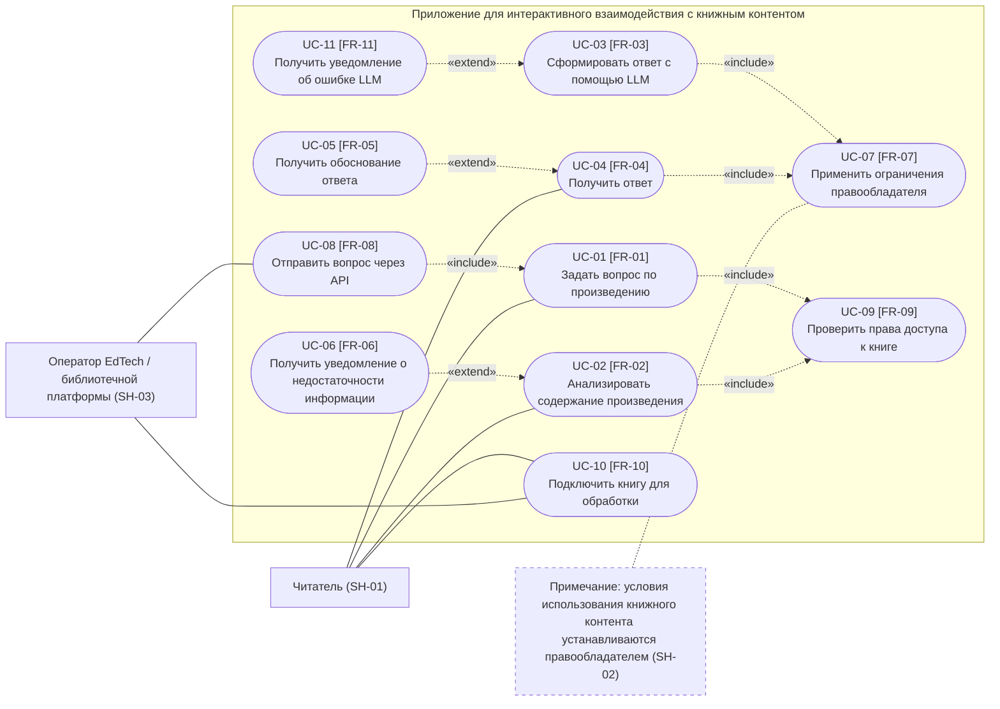

# Лабораторная работа №1. Формулирование требований к программной системе

| Поле | Значение |
|---|---|
| **Студент** | Морозова Светлана Евгеньевна |
| **Группа** | РИС-23-1 |
| **Вариант** | Тема ВКР: "Разработка приложения для интерактивного взаимодействия с книжным контентом на основе искусственного интеллекта для использования в EdTech и библиотечных платформах" |
| **Постановка задачи** | https://docs.google.com/document/d/1UdWiC1SEMeF3XHEKz1KwmectyuIy9-vtV7bFIUxQyjI/edit?usp=sharing |
| **Репозиторий** |  https://github.com/SvetikMorozova/Designing-the-architecture-of-software-systems |
| **Дата сдачи** | 06.12.2026 |

**Тема:** Разработка приложения для интерактивного взаимодействия с книжным контентом на основе искусственного интеллекта для использования в EdTech и библиотечных платформах

**Цель работы:** Научиться анализировать поставленную задачу, выделять заинтересованных лиц, формулировать функциональные и нефункциональные требования, представлять результаты в виде диаграммы вариантов использования.

---

## Краткое описание системы
Приложение позволяет задавать вопросы по содержанию произведений, анализировать сюжет, персонажей и мотивы их поступков. Ответы формируются на основе исходного текста с учётом ограничений правообладателей. Система направлена на снижение доли недостоверных и неподтверждённых исходным текстом ответов, генерируемых языковыми моделями.

Практическая значимость работы заключается в возможности применения разработанного приложения для расширения функциональности образовательных платформ и электронных библиотек. Предлагаемое решение может использоваться для организации диалогового взаимодействия с учебной и художественной литературой, поддержки самостоятельного обучения, поиска информации в книжных материалах и повышения удобства работы пользователей с электронными книжными ресурсами.

---

## Оглавление

1. [Стейкхолдеры](#1-перечень-заинтересованных-лиц-стейкхолдеров)
2. [Функциональные требования](#2-перечень-функциональных-требований)
3. [Диаграмма вариантов использования](#3-диаграмма-вариантов-использования)
4. [Предположения](#4-перечень-сделанных-предположений)
5. [Нефункциональные требования](#5-перечень-нефункциональных-требований-повышенная-сложность)
6. [Чек-лист самопроверки](#6-чек-лист-самопроверки)

---

## 1. Перечень заинтересованных лиц (стейкхолдеров)

Выделела три ключевых стейкхолдера, включая 2 внешних.

| ID | Стейкхолдер | Роль | Интересы / цели | Влияние |
|----|-------------|------|-----------------|---------|
| SH-01 | Читатель (студент, преподаватель, посетитель библиотеки) | Основной пользователь системы | Быстро находить правильные ответы в книге, анализировать предоставленный источник литературы, интерактивное взаимодействие с книжным контентом | Высокое: ежедневно использует ключевые функции, определяет полезность продукта|
| SH-02 | Правообладатель книжного контента | Внешний участник, определяющий условия использования книг | Ограничивать обработку и выдачу текста; предотвращать неразрешённое раскрытие произведений | Высокое: ограничения лицензии могут исключать обработку отдельных книг |
| SH-03 | Оператор EdTech / библиотечной платформы | Заказчик и интегратор, заинтересованный во внедрении приложения в существующую информационную систему | Встроить функции вопросов и ответов для привлечения большего количества пользователей | Высокое: принимает решения о внедрении и интеграции |

---

## 2. Перечень функциональных требований

11 требований: 9 Must и 2 Should. Приоритеты определены по MoSCoW.

| ID | Требование | Стейкхолдер | Приоритет (MoSCoW) | Обоснование |
|----|------------|-------------|---------------------|-------------|
| FR-01 | Система должна принимать текстовый вопрос пользователя по выбранной книге | SH-01 | Must | Основной способ интерактивного взаимодействия |
| FR-02 | Система должна выполнять содержательный анализ произведения в соответствии с пользовательским запросом, опираясь на исходный текст книги | SH-01 | Must | Позволяет понимать сюжет, персонажей и мотивы их поступков |
| FR-03 | Система должна передавать пользовательский запрос и релевантный контекст произведения языковой модели для формирования ответа | SH-01 | Must | Обеспечивает контекстно-зависимые ответы |
| FR-04 | Система должна отображать пользователю сгенерированный ответ на заданный вопрос | SH-01 | Must | Предоставляет результат основной операции |
| FR-05 | Система должна предоставлять текстовое обоснование ответа на основе содержания произведения с учётом ограничений правообладателя | SH-01, SH-02 | Should | Позволяет оценить обоснованность ответа |
| FR-06 | Система должна уведомлять пользователя о недостаточности информации в тексте произведения для формирования обоснованного ответа | SH-01 | Must | Снижает риск недостоверных ответов |
| FR-07 | Система должна применять заданные ограничения правообладателя на передачу и отображение фрагментов книги | SH-02, SH-03 | Must | Обеспечивает соблюдение условий использования контента |
| FR-08 | Система должна предоставлять оператору платформы API для отправки вопроса с идентификатором доступной книги | SH-03 | Must | Обеспечивает интеграцию |
| FR-09 | Система должна проверять право доступа пользователя к выбранной книге | SH-02, SH-03 | Must | Предотвращает обработку недоступного контента |
| FR-10 | Система должна предоставлять возможность подключения книги для обработки с указанием идентификатора и условий использования | SH-02, SH-03 | Must | Обеспечивает получение книжного контента |
| FR-11 | Система должна уведомлять пользователя о невозможности формирования ответа при ошибке взаимодействия с языковой моделью | SH-01 | Should | Информирует о технических ошибках |

---

## 3. Диаграмма вариантов использования

Каждый UC связан с FR. Правообладатель представлен примечанием: прямое взаимодействие с приложением не предусмотрено. Подключение книги в самостоятельном режиме выполняет уполномоченный читатель.

### Диаграмма

**Исходный код диаграммы:** [use-case.mmd](../src/use-case.mmd)

### Описание ключевого сценария

| Поле | Значение |
|---|---|
| **Use Case** | UC-02 [FR-02] Анализировать содержание произведения |
| **Актор** | Читатель (SH-01) |
| **Предусловие** | Книга подключена к системе и выбрана пользователем. Установлены условия использования книжного контента |
| **Основной поток** | 1. Читатель задаёт вопрос по произведению (UC-01) 2. Система проверяет права доступа (UC-09) 3. Система определяет релевантный контекст произведения 4. Проверяет ограничения правообладателя (UC-07) 5. Передаёт запрос и разрешённый контекст языковой модели (UC-03) 6. Отображает сформированный ответ (UC-04) и, если возможно, его обоснование (UC-05) |
| **Постусловие** | Пользователю предоставлен ответ по содержанию произведения с соблюдением условий использования книжного контента |
| **Альтернативный поток** | При отсутствии прав доступа обработка прекращается. При недостаточности информации система уведомляет пользователя (UC-06). При ошибке взаимодействия с языковой моделью система выводит соответствующее уведомление (UC-11) |

---

## 4. Перечень нефункциональных требований

Числовые критерии являются предварительными проектными целями.

| ID | Категория | Требование | Метрика / критерий приёмки | Почему выбрано |
| --- | --- | --- | --- | --- |
| NFR-01 | Performance | Система должна обрабатывать запросы за ограниченное время | 100 запросов, p95 полного времени ответа ≤ 15 с при 10 одновременных запросах | Длительное ожидание снижает интерактивность |
| NFR-02 | Deployability | Система должна поддерживать локальное и серверное развёртывание в виде веб-приложения | Два варианта развёртывания; все Must-функции проходят тесты без изменения исходного кода | Различная IT-инфраструктура и самостоятельная эксплуатация |
| NFR-03 | Security | Система должна защищать передаваемые данные и предотвращать несанкционированный доступ | 100% внешних HTTP-соединений; 100% запросов к закрытым книгам проверяются на доступ; 0 критических уязвимостей по результатам тестирования | Защита лицензируемых текстов и пользовательских данных |
| NFR-04 | Answer quality | Система должна формировать корректные и обоснованные ответы по тексту произведения | На наборе из 50 вопросов ≥ 90% фактических утверждений подтверждаются текстом; ≥ 90% аналитических ответов признаны обоснованными экспертами | Недостоверные ответы и искажение содержания - ключевые риски |
| NFR-05 | Usability | Система должна обеспечивать простое взаимодействие посредством вопросов и ответов | ≥ 90% участников самостоятельно отправляют первый вопрос не более чем за 3 действия после открытия системы | Различный уровень технической подготовки читателей |

---

## 5. Перечень сделанных предположений (повышенная сложность)

<Вводное предложение: что «додумано» из-за неполноты постановки.>

| ID | Предположение | Влияние на требования |
|----|---------------|-----------------------|
| A-01 | Русскоязычный интерфейс и книжный контент | Выбор LLM и тестовых наборов |
| A-02 | Самостоятельное использование и интеграция с платформами | FR-08, NFR-02 |
| A-03 | При интеграции права доступа и сведения о книгах предоставляет оператор; в самостоятельном режиме их задаёт уполномоченный пользователь при подключении | FR-07, FR-09, FR-10 |
| A-04 | Условия использования задаются заранее | FR-07 |
| A-05 | Поиск номеров страниц, позиций слов и подсчёт вхождений не предусмотрены | FR-01, FR-02, FR-05 |
| A-06 | Качество оценивается на контрольном наборе с экспертной проверкой соответствия тексту, логичности и полноты | NFR-04 |
| A-07 | Платные подписки и встроенная оплата не предусмотрены | Исключает платёжные интеграции |
